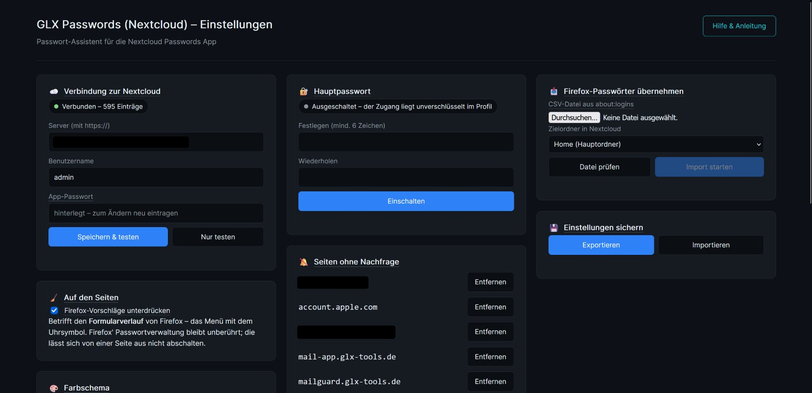
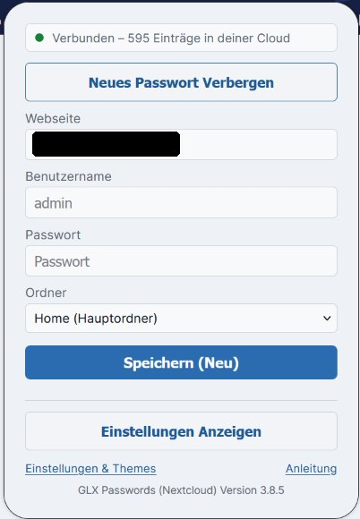
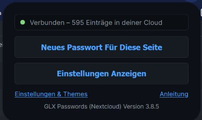
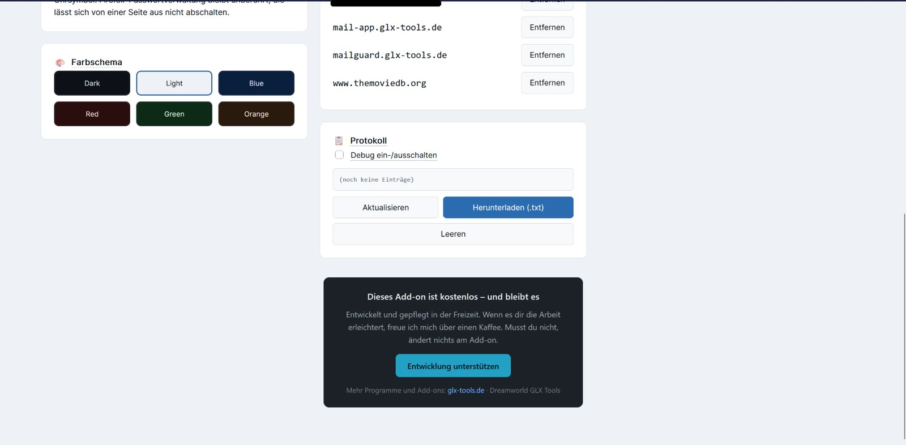
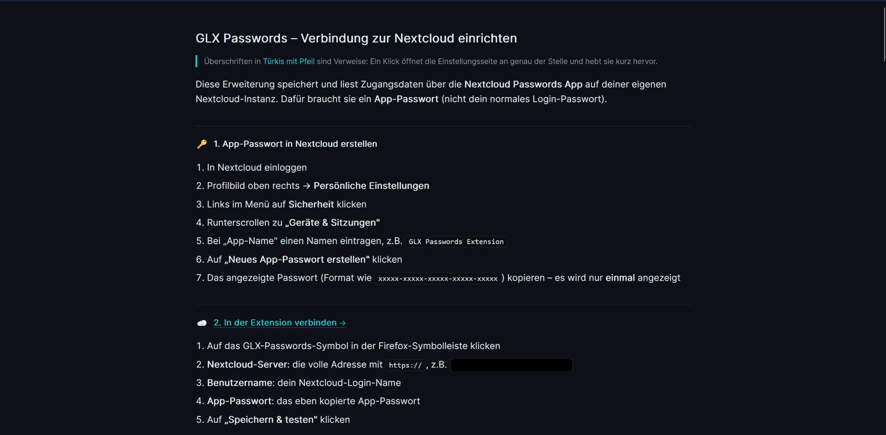

🌍 Languages: [🇺🇸 English](README.md) | [🇩🇪 Deutsch](README.de.md)

# 💠 GLX Passwords

### Your Nextcloud passwords in Firefox.

*Recognizes login forms, fills them in and saves new logins to the Passwords app of your own Nextcloud.* ⚡

   

---

## ⬇️ Download

👉 Latest version: [Releases](../../releases/latest)  
👉 Shop and licences: [glx-tools.de](https://glx-tools.de/product/glx-passwords/)

---

## 📖 About GLX Passwords

### Your Nextcloud passwords in Firefox

GLX Passwords connects Firefox with the Passwords app of your own Nextcloud. It recognizes login forms, including multi-step logins where user name and password come on separate pages, fills them in and offers to save new or changed logins. Your passwords stay in your own Nextcloud, encrypted, and are never sent anywhere else.

### Several accounts, folders and tags

Several accounts per website are supported: you pick the right one in a small selection window, save a login as a new entry or update an existing one. Logins can be sorted into folders and marked with tags, and the selection window shows tags and the first note line.

### Address data with one click

Personal data such as name, street, postcode or phone number for address forms is stored in your Nextcloud as well and filled only into clearly matching fields. If there are several values, you choose when you click into the field.

### Locked with a master password

A master password locks access until Firefox is closed. GLX Passwords runs alongside Firefox's own password manager without you having to change anything.

### Easy to set up

Clear settings with cards, several colour themes and built-in help. Connection, master password and import are at the top, everything else is explained step by step.

---

## 📸 Overview & Screenshots

### 1️⃣ Settings: Nextcloud connection, master password, Firefox import

### 2️⃣ Save a new password straight from the toolbar

### 3️⃣ Toolbar window with connection status

### 4️⃣ Step-by-step guide for the Nextcloud connection

### 5️⃣ Light colour scheme, log and site exceptions

---

## ✨ Features

- 🚀 **Works with your own Nextcloud:** Uses the Passwords app of your Nextcloud as the safe store, nothing goes to third parties.
- 🧩 **Detects login forms:** Recognizes real login forms, also multi-step logins with user name and password on separate pages.
- ⚙️ **Fills in with one click:** Choose the right login and the fields are filled in.
- 🔒 **Several accounts per site:** Pick the right account in a selection window; save as a new entry or update an existing one.
- 📂 **Folders and tags:** Sort logins into folders, tag them when saving and filter by tag.
- ⚡ **Address data:** Name, street and other form data are stored and filled only into clearly matching fields.
- 🎨 **Choice for multiple values:** If there are several values for a field, you choose when you click into it.
- 🌍 **Master password lock:** Access stays locked until you enter the master password once per Firefox session.
- 🛠️ **Clear settings:** Connection, master password and import at the top, everything else in tidy cards with explanations.
- 📊 **Themes and help:** Several colour themes and built-in help.

---

## 🧩 Requirements

- Firefox
- Your own Nextcloud with the Passwords app

---

## 🧪 Trial & License

See [glx-tools.de](https://glx-tools.de).

---

## 🔐 Privacy

Passwords are stored only in your own Nextcloud and are never sent to third parties.

---

## 🔗 More about this product

👉 [glx-tools.de](https://glx-tools.de/product/glx-passwords/)  
For support: **info@glx-tools.de**

---

## 📄 License

Copyright © 2026 GLX Tools – Gordon Lehmann. All rights reserved.  
This is proprietary commercial software. No open-source license is granted. This repository contains release downloads and documentation only; the source code is not published.

---

Made with ❤️ by **Dreamdancer100**

